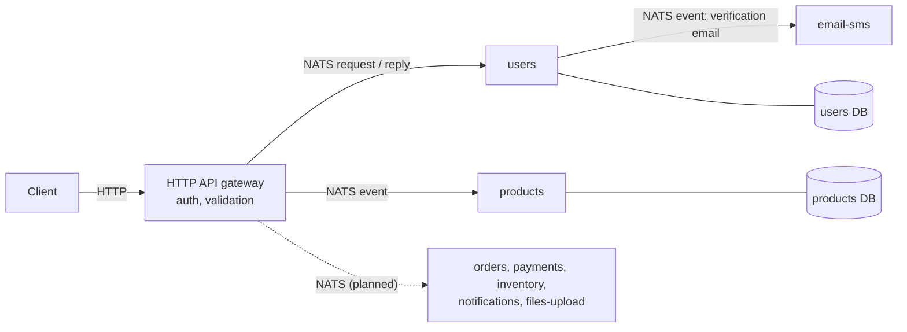

<h1 align="center">E-commerce microservices</h1>

<p align="center">
  The backend of an online shop split into NestJS microservices: one HTTP gateway,
  services that talk over NATS, and a PostgreSQL database per service.
</p>

<p align="center">
  
  
  
  
  
  
</p>

## Overview

A learning project on microservice architecture: each business area of a shop (users, products, orders, payments, inventory, notifications, files, email) is its own NestJS service with its own database. Clients only talk to the **HTTP API gateway**; the gateway turns each request into a message on **NATS**, and the service in charge answers it (request/response) or reacts to it (events).



## Status

The architecture and the infrastructure are in place for every service; the business logic is written for authentication, users, emails and the start of the product catalogue.

| Service                      | Status                                                                                                   |
| ---------------------------- | -------------------------------------------------------------------------------------------------------- |
| `http-api-gateway`           | **Working.** Auth routes, JWT and Google OAuth strategies, role guard, validation, error mapping from the services |
| `users-microservice`         | **Working.** Register, login, logout, verification codes, password reset and change, Google sign-in (bcrypt, Prisma) |
| `email-sms-microservice`     | **Working** for email: verification, welcome, account confirmation, password reset and change templates (Nodemailer). SMS is a stub |
| `products-microservice`      | **Started.** Product, category and review models; product creation through an event                      |
| `orders-microservice`        | Scaffolded: NestJS app, NATS transport, Prisma setup                                                      |
| `payments-microservice`      | Scaffolded                                                                                                |
| `inventory-microservice`     | Scaffolded                                                                                                |
| `notifications-microservice` | Scaffolded                                                                                                |
| `files-upload-microservice`  | Scaffolded                                                                                                |

## Features

- **API gateway:** a single public entry point on port 3000; DTO validation with `class-validator`; JWT authentication, Google OAuth 2.0 and role-based guards; errors raised in a service come back as proper HTTP responses.
- **Authentication flow:** sign-up with an email verification code, login with JWT, password reset by emailed code, password change, and sign-in or sign-up with Google, implemented across the gateway, the users service and the email service.
- **Messaging:** request/response patterns (`auth.register`, `auth.login`, `auth.verifyCode`, `auth.resetPassword`, `auth.changePassword`, `auth.googleValidate`...) and events (`sendVerificationEmail`, `create-product`) over NATS.
- **Database per service:** each service owns its PostgreSQL database and Prisma schema; no service reads another one's tables.
- **One command to run everything:** Docker Compose starts NATS, the databases and all the services with hot reload.

## API (gateway)

| Method | Route                   | Purpose                                         |
| ------ | ----------------------- | ----------------------------------------------- |
| POST   | `/auth/send-code`       | Send an email verification code                 |
| POST   | `/auth/register`        | Create an account                               |
| POST   | `/auth/login`           | Log in, returns a JWT                           |
| POST   | `/auth/verify-code`     | Check a verification code                       |
| POST   | `/auth/reset-password`  | Reset a forgotten password                      |
| POST   | `/auth/change-password` | Change the password                             |
| GET    | `/auth/google/sign`     | Sign in (or sign up) with Google                |
| GET    | `/auth/google/callback` | Google OAuth callback                           |
| POST   | `/products`             | Create a product (forwarded as an event)        |

## Tech stack

| Area           | Tools                                                     |
| -------------- | --------------------------------------------------------- |
| Services       | NestJS, TypeScript, `@nestjs/microservices`               |
| Messaging      | NATS                                                      |
| Data           | PostgreSQL 13, one database per service, Prisma           |
| Authentication | Passport (JWT, Google OAuth 2.0), bcrypt, express-session |
| Email          | Nodemailer                                                |
| Infrastructure | Docker, Docker Compose                                    |

## Getting started

**Requirements:** Docker with Docker Compose (and Node.js to run a service outside Docker).

```bash
git clone https://github.com/ay-boutera/microservices_E-commerce.git
cd microservices_E-commerce

# copy each service's .env.example to .env and fill in the values, then:
npm run docker:up        # or ./start-services.sh
npm run docker:logs
```

The gateway listens on http://localhost:3000. NATS is on port 4222 and the databases on ports 5433 to 5439.

| Script                                     | What it does                         |
| ------------------------------------------ | ------------------------------------ |
| `npm run install:all`                      | `npm install` in every service       |
| `npm run build:all`                        | Builds every service                 |
| `npm run docker:up` / `docker:down`        | Starts or stops the whole stack      |
| `npm run lint`, `npm run format`           | ESLint and Prettier on every service |

### Configuration

| Service                | Variables                                                                                   |
| ---------------------- | ------------------------------------------------------------------------------------------- |
| `http-api-gateway`     | `PORT`, `JWT_SECRET`, `SESSION_SECRET`, `GOOGLE_CLIENT_ID`, `GOOGLE_CLIENT_SECRET`, `GOOGLE_CALLBACK_URL`, `FRONTEND_URL` |
| `email-sms-microservice` | `EMAIL_USERNAME`, `EMAIL_PASSWORD`                                                        |
| Services with a database | `DATABASE_URL`, `NODE_ENV`                                                                |

## Project structure

```
http-api-gateway/             # the only HTTP entry point
users-microservice/           # accounts and authentication
email-sms-microservice/       # emails (templates) and SMS
products-microservice/        # catalogue: products, categories, reviews
orders-microservice/          # scaffolded
payments-microservice/        # scaffolded
inventory-microservice/       # scaffolded
notifications-microservice/   # scaffolded
files-upload-microservice/    # scaffolded
docker-compose.yml            # NATS, one PostgreSQL per service, all the services
```

## Author

[Boutera Ahmed Yassine](https://github.com/ay-boutera)
